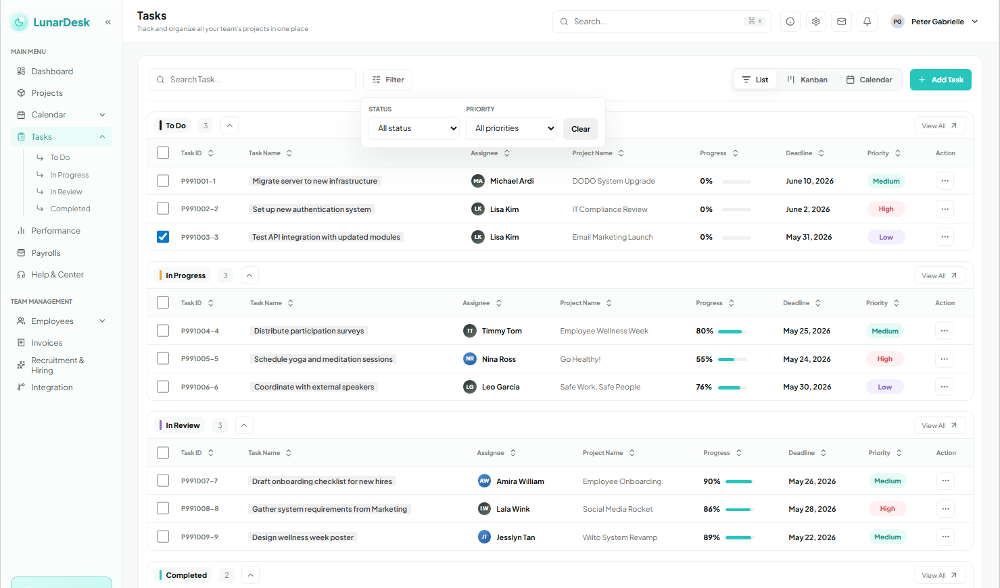
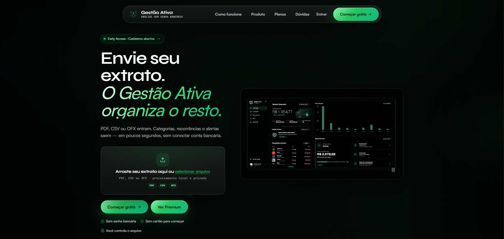
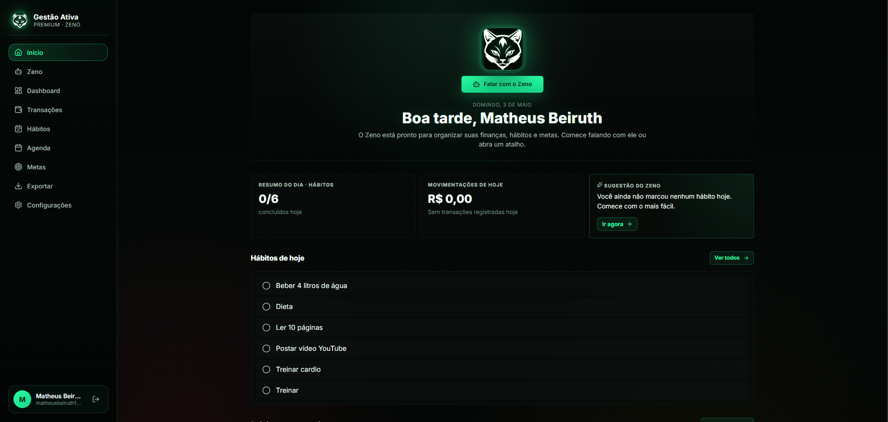
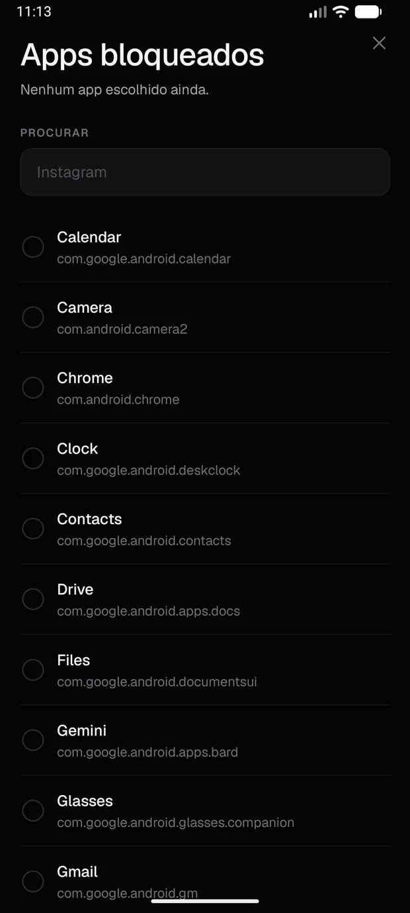
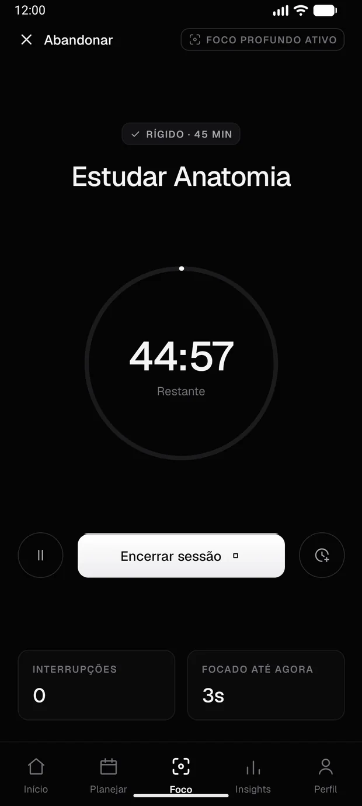

# Matheus Beiruth

**Software Engineer**

Backend developer based in Maricá, Brazil, working mostly in Python and Java. I build REST APIs and event-driven systems: a task management API structured as a modular monolith with ports and adapters, covered by 55 automated tests; a mobility backend that publishes ride events to RabbitMQ and settles driver balances atomically in Redis; a personal finance SaaS that parses bank statements out of PDF and CSV and categorizes transactions on its own. On the front end I work with TypeScript, React and Next.js, and I have shipped an offline Android app whose focus sessions block other apps through a native Kotlin accessibility service. Currently studying LLM applications — RAG, agents and the Model Context Protocol.

📍 Maricá, RJ · [LinkedIn](https://linkedin.com/in/matheusbeiruth) · matheusbeiruth10@gmail.com

---

### 💻 Languages and Tools

  
  
  <picture>
    <source media="(prefers-color-scheme: dark)" srcset="https://cdn.simpleicons.org/django/white" />
    
  </picture>
  
  
  
  
  
  <picture>
    <source media="(prefers-color-scheme: dark)" srcset="https://cdn.simpleicons.org/nextdotjs/white" />
    
  </picture>
  
  
  
  
  
  
  
  <picture>
    <source media="(prefers-color-scheme: dark)" srcset="https://cdn.simpleicons.org/linux/white" />
    
  </picture>
  
  
  <picture>
    <source media="(prefers-color-scheme: dark)" srcset="https://cdn.simpleicons.org/pandas/white" />
    
  </picture>

---

## Agora

- Estudando LLMs, RAG, agentes e Model Context Protocol (MCP)
- Próximo projeto: um sistema de **RAG** com FastAPI, PostgreSQL/pgvector e avaliação de qualidade

## Projetos em Destaque

### [Trackio](https://github.com/BeiruthDEV/TaskManagerAPI)
API de gestão de tarefas em monólito modular (ports/adapters), com Kanban, dashboard, 55 testes automatizados (unitários, integração e BDD), CI e deploy.

  

### [TransFlow](https://github.com/BeiruthDEV/transflow-backend)
API de mobilidade orientada a eventos: registra corridas, publica eventos no RabbitMQ e um worker atualiza o saldo do motorista de forma atômica no Redis.

  

### [Gestão Ativa](https://github.com/BeiruthDEV/gestao-ativa-demo)
SaaS de finanças pessoais com dashboard, leitura de extratos em PDF/CSV, categorização automática de transações e detecção de recorrências.

  
  

### [StayOn](https://github.com/BeiruthDEV/StayOn)
App Android de foco e produtividade, offline e sem conta: tarefas, hábitos, agenda em blocos e sessões de foco com bloqueio de apps via módulo nativo em Kotlin.

  
  

### [Orbia](https://github.com/BeiruthDEV/Orbia)
Sistema web em Django para gestão de empresas, representantes, projetos e pesquisas, com mapas, dashboards e permissões por tipo de usuário.

  

## Currículo

📄 [Baixar currículo (PDF)](./assets/CV_Matheus_Beiruth_BackEnd_2026.pdf)

